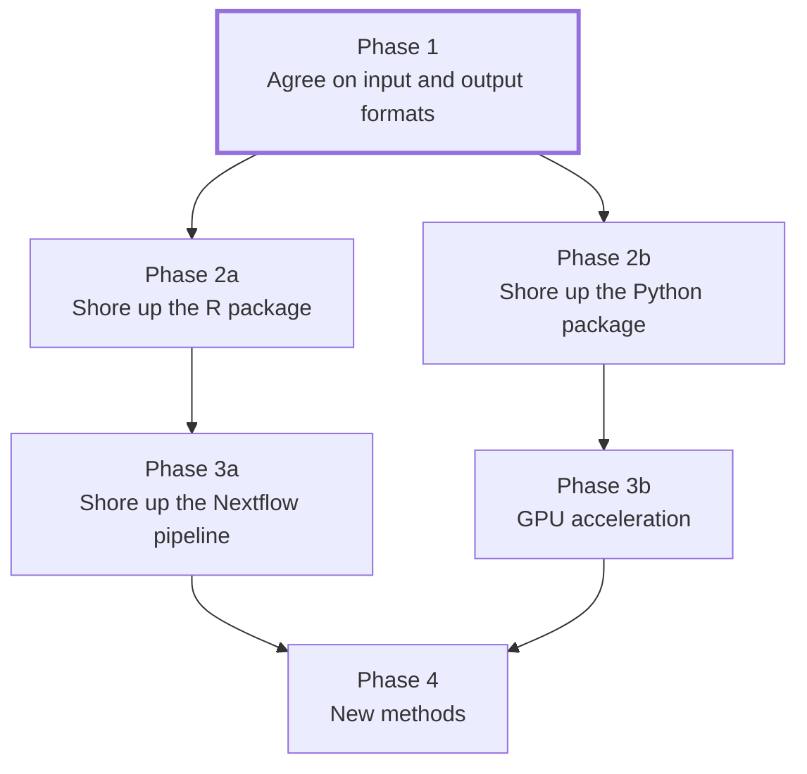

# SCEPTRE roadmap

This roadmap covers the R package (sceptre), the Python package (pysceptre)
and the Nextflow pipeline. Work proceeds in four phases. An arrow means
"finish this before starting that"; the two halves of a phase run in parallel.

Phase 1 is in progress.

| Phase | What it delivers |
| --- | --- |
| **1. Formats** | One set of files on disk, read natively by R and Python: the data, and the output of an analysis, both final and stage by stage. These are two formats with separate versions: a Perturb-seq data file format, meant for use beyond sceptre, and a sceptre analysis format. The drafts are in [`file-format/`](file-format/). |
| **2a. R package**, **2b. Python package** | Each package made maintainable and extensible, reading and writing the shared files, and working with its ecosystem's standard objects (Bioconductor, scverse). The two packages give the same output as each other, and the same results as today. |
| **3a. Nextflow pipeline** | The pipeline made maintainable and extensible on top of the stable package interfaces, and scaled to large screens. |
| **3b. GPU acceleration** | Full-scale analyses on GPU in pysceptre, matching CPU results. |
| **4. New methods** | A minimal subset of new statistical methods, for example the saddlepoint approximation and pairwise QC. |

## Priorities

- **Quality over speed.** Development is not planned around external dates.
- **Foundations before extensions.** New features wait until the formats and
  both packages are sound.
- **Among extensions, scalability, maintainability, extensibility and
  interoperability before new methods.** GPU acceleration and the pipeline
  come before method development.

## Waiting until Phase 4 or later

Improved gRNA assignment, the Wilcoxon test, per-pair power, improved
calibration, and improved upstream bioinformatics.
