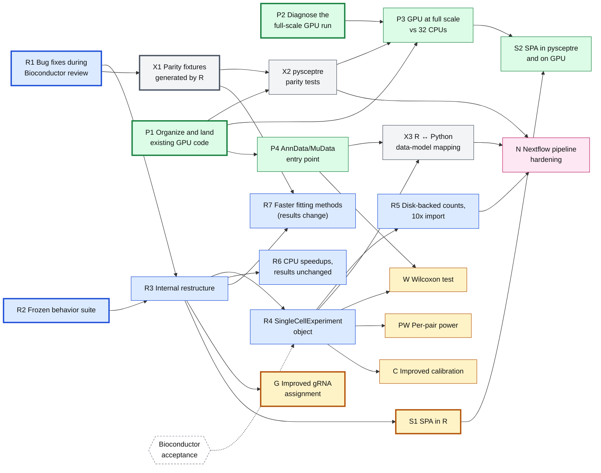

# SCEPTRE roadmap

Last reviewed: October 2026.

This roadmap covers the whole SCEPTRE ecosystem: the R package, pysceptre and
the Nextflow pipeline. It is a dependency graph rather than a ranked list. An
arrow means "finish this before starting that". Work with no path between it can
run in parallel.

Each item is marked **Now** (in progress or ready to start), **Next** (waiting on
an item marked Now) or **Later** (further down the graph, or needing a proposal
first).

Colors: blue = R package, green = pysceptre, gray = shared, amber = new or
changed statistical methods, pink = Nextflow pipeline. A bold border marks items
that are Now. The dashed hexagon is the Bioconductor acceptance gate.

## Items

| Item | What it delivers | Depends on | Where | Status |
| --- | --- | --- | --- | --- |
| **R1 Bug fixes during review** | Fixes found during the internal refactor, plus responses to the Bioconductor reviewer | — | R | Now |
| **R2 Frozen behavior suite** | Tests that pin the current behavior of the released package, so later changes can be checked against it | — | R | Now |
| **R3 Internal restructure** | Clear internal modules for cell selection, count access, fitting, QC, inference and results, with results unchanged | R1, R2 | R | Next |
| **R4 SingleCellExperiment object** | The analysis object built on `SingleCellExperiment`, import from an existing SCE, and migration of objects saved by the released version. Developed on `dev`; merged after Bioconductor acceptance. | R3 | R | Next |
| **R5 Disk-backed counts and 10x import** | Disk-backed counts through HDF5Array/DelayedArray, and 10x Genomics import | R4 | R | Later |
| **R6 CPU speedups, results unchanged** | Speedups already implemented on development branches, where together they ran a full Gasperini permutation analysis 4.8× and a CRT analysis 3.6× faster than the released version, with identical output. They include native Poisson fitting, a dispersion cache, a fused scoring kernel, shared permutation prefixes, faster QC and import, and fit reuse. Brought over one at a time, each with unchanged results and a timing. | R3 | R | Next |
| **R7 Faster fitting methods (results change)** | Prototyped accelerations that change numerical results: an accelerated logistic fitter for CRT, marginal guide-fit initialization, and a native binomial QR fitter. Each needs a method proposal and validation. | R3, X1, a proposal | R | Later |
| **P1 Organize and land existing GPU code** | Existing GPU, native sampler and execution code reviewed and merged in pieces | — | pysceptre | Now |
| **P2 Diagnose the full-scale GPU run** | One instrumented full-scale GPU CRT run that shows where the time goes | — | pysceptre | Now |
| **P3 GPU at full scale** | Full-screen CRT and permutation on GPU, matching CPU results, with a timing table against 32 CPU cores | P1, P2, X2 | pysceptre | Next |
| **P4 AnnData/MuData entry point** | Analyses run directly on AnnData/MuData, including disk-backed data | P1 | pysceptre | Next |
| **X1 Parity fixtures** | Small fixtures generated by R, and a reference stability test in R ([parity contract](contracts/parity.md)) | R1 | R | Now |
| **X2 pysceptre parity tests** | pysceptre checked against the R fixtures in CI | X1, P1 | pysceptre | Next |
| **X3 Data-model mapping** | Fixture inputs provided as both SCE and AnnData/MuData, and a short note on how fields correspond | R4, P4 | Both | Later |
| **G Improved gRNA assignment** | The overhauled assignment method, validated and integrated | R3 | R, then pysceptre | Now (method); integration Next |
| **S1 SPA in R** | Saddlepoint approximation for resampling p-values, chosen among the existing prototypes and validated | R3, a method proposal | R | Now (proposal); implementation Next |
| **S2 SPA in pysceptre and on GPU** | The same method in Python, following the R reference | S1, P3 | pysceptre | Later |
| **W Wilcoxon test** | Wilcoxon as an additional association test. Prototypes exist in both packages. | R4, P4 | Both | Later |
| **N Nextflow hardening** | Containers, tests, CI, array jobs and nf-core-style documentation, on top of stable package interfaces | R5, X2, X3 | Pipeline | Later |
| **PW Per-pair power** | Power or minimum detectable effect for each pair, building on [PerturbPlan](https://katsevich-lab.github.io/perturbplan/) | R4 | R first | Later |
| **C Improved calibration** | Assessing false discovery control under realistic mixtures of null and non-null pairs, empirical calibration with negative controls, principal components as covariates. Research can start any time; software follows R4. | R4 | R first | Later |

## Notes

- **The Bioconductor gate.** The R package was
  [submitted](https://github.com/Bioconductor/BiocContributions/issues/176) in
  August 2026. Until it is accepted, the submitted version receives only R1.
  R3 onward is developed on a `dev` branch and merged after acceptance.
- **R is the reference implementation.** Method changes (G, S1, and anything
  under C or PW) land in R first; pysceptre follows through the parity fixtures.
- **Why Nextflow comes late.** The pipeline wraps the packages. Hardening it
  before their data structures and interfaces settle would mean redoing the
  work.
- **Method changes need a proposal** before implementation: G, S1, R7, PW and
  C.

## Not on the roadmap

Considered and set aside for now:
- Seurat interoperability.
- Distributed execution inside the R package (the pipeline covers this).
- Result bundles and resource summaries.
- glmGamPoi fitting of the gene models. It replaces the Poisson fit plus
  dispersion estimate with a full negative binomial fit, which is a different
  estimator rather than a speedup; native Poisson fitting (R6) already speeds up
  the current method.

Any of these can return through a proposal.

## Reviewing this roadmap

The maintainers review the roadmap at least quarterly, and when an item
finishes. Changes are made by pull request to this file.
